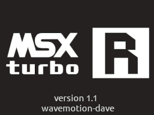
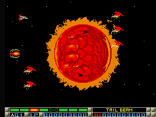
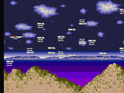
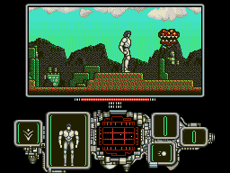
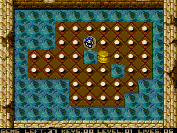
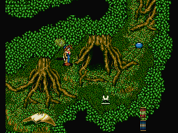
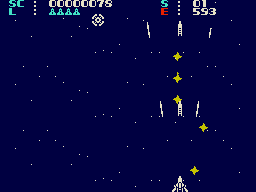
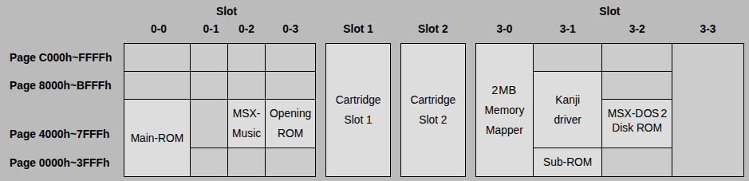

# Vroom-DS - MSX Turbo-R Emulator for the DSi/XL/LL

Requires a DSi/XL/LL and will NOT run in DS-Lite or 'Compatibility' mode. The game
will check to make sure you have the needed processing power and RAM to run the game.

# Donations Welcome (but never required!)

These hobby emulators have been a labor of love. An embarassing amount of development time has gone into it as I've strived to provide an enjoyable retro experience on the DS handheld. It's free to use and always will be, however if you feel inclined to buy me a virtual coffee for the effort, that would be beyond amazing!

Brief Instructions :
-----------------------
In addition to the Vroom-DS.nds file, you will need 3 files in the /roms/bios directory to use this emulator:

* fs-a1gt_firmware.rom (4MB) with CRC32 of 0xfeefeadc
* hb-f1xdj_kanjifont.rom (256K) with CRC32 of 0x7016dfd0
* ascii_msxdos22.rom (64K) with CRC32 of 0x47eea028

(for that last one, you can substitute MDOS22V3.ROM with CRC32 of 0x845f5ab6)
or
(for that last one, you can substitute MSXDOS22.ROM with CRC32 of 0x1c430991)

Copyright :
-----------------------
Vroom-DS is Copyright (c) 2026 Dave Bernazzani (wavemotion-dave)

As long as there is no commercial use (i.e. no profit is made),
copying and distribution of this emulator, it's source code
and associated readme files, with or without modification, 
are permitted in any medium without royalty provided this 
copyright notice is used and wavemotion-dave (Vroom-DS),
and Marat Fayzullin (fMSX core) are thanked profusely.

The sound driver (ay38910) are libraries from FluBBa (Fredrik Ahlström) 
and those copyrights remain his.

lzav compression (for save states) is Copyright (c) 2023-2025 Aleksey 
Vaneev and used by permission of the generous MIT license.

The Vroom-DS emulator is offered as-is, without any warranty.

Credit to @PantheonMusic - Opening "Fast Pace Dramatic Score" music

What is Worth Playing
-----------------------

There aren't more than about 40 games total for the turbo-R. It was well past twilight for the MSX systems 
when it came out and most developers had moved on to other systems (Amiga, PC, SNES, Genesis, etc). But there
are some real gems for the turbo-R in that small group. I'll highlight 10 of the games that I really enjoyed.

| Game     | Description |
| -------- | --------    |
|   | Gradius 3. This is not a turbo-R exclusive but there is a Victor Martínez enhancement patch version that offers amazing smooth scroll and R800 handling on the turbo-R. Seek it out! |
|   | Hoippuru in the Magical Land. A cute puzzle game with bright, colorful graphics that is worth a play. |
|   | Illusion City. Many consider this to be the best turbo-R game ever made. Cyberpunk futuristic thriller of an RPG and well worth playing. Use the ASCII16X 4MB ROM. |
|   | Multi-Plex. They said parallax scrolling was too difficult to pull off during gameplay. This fast horizontal shooter proves them wrong. |
|   | Paradream. A solid Parodius-em-up shooter that has beautiful color and level presentation.|
|   | Seed of Dragon. One of the few games that features voices done via PCM. The semi-recent English Translation even translates the voices into English. |
|   | Treasure of Babylon. Another puzzle game that for some reason I really dig - slow paced so you can just think ahead.|
|   | Moonlight Saga. Along with Illusion City, often considered one of the very best the turbo-R has to offer. A colorful game that will please RPG fans.|
|   | Stage 11 Kai. No idea why this isn't just an MSX1 game but it's still quite good battling a single boss trying to outlast it.|

Virtual Slot Map :
-----------------------

Known Issues :
-----------------------
* Speed is not fully accurate. It's the best I could do on the little handheld... some games play just fine and others will have slowdown.
* The MSX Translations version of Illusion City only runs in the 4MB ASC16X ROM version (which is more convenient anyway). You can use Flash or SRAM to save progress.
* Daraiayu Taikenban hits this emulation HARD and as such is glitchy. PCM is enabled but due to the slowdown, it doesn't sound very good.
* STG Special has major graphical glitches happening in the score area. Reason unknown but probably inaccurate R800 timing.
* Don't try to run non-Turbo-R games on this thing... most of the MSX mappers are not present and SCC emulation is missing. Use Hachibitto for your general MSX emulation needs - this is to play around with Turbo R games.

Version History :
-----------------------
Version 0.9 - 18-Nov-2026 by wavemotion-dave
* Absolute max optimization of CPU read/write throughput. We now sacrifice VDP speed for CPU speed since on the turbo-R that's the bottleneck.
* Fix for a few turbo-R games that were not running at the optimal settings.
* Direct screen render improved.

Version 0.8 - 15-Nov-2026 by wavemotion-dave
* Added real DRAM mode handling for BIOS shadow.
* Improved audio output - AY now centers at zero. Clicks gone.
* A few more individual game tweaks for improved gameplay.
* Minor bug fixes and cleanup as time permitted.
* 0.8a with reworked CPU read/write memory handling for an almost 10% speedup!
* 0.8b with direct write to VRAM for another 1-2 frames of performance. Fix for Stage 11 Kai.

Version 0.7 - 15-Nov-2026 by wavemotion-dave
* Real R800 timing and actual CPU context switching for improved accuracy.
* PCM buffer so voice samples sound better.
* SCC added back from Hachibitto so games like Goonies R Enough with voice now work as does games like Nemesis 3 with Turbo R enhancements (no slowdown, smooth scroll, etc).
* New Turbo 'Flame' icon when running in Turbo-R native R800 mode.
* Lots of other bug fixes and improvements as time permitted.

Version 0.6 - 14-Nov-2026 by wavemotion-dave
* Minor bug fixes.

Version 0.5 - 13-Nov-2026 by wavemotion-dave
* First beta version released.

