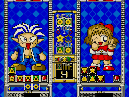
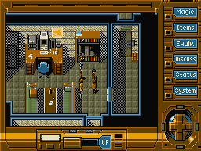
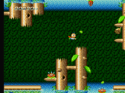
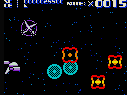

# Vroom-DS - MSX turbo-R Emulator for the DSi/XL/LL

Requires a DSi/XL/LL and will NOT run in DS-Lite or 'Compatibility' mode. The game
will check to make sure you have the needed processing power and RAM to run the game.

# Donations Welcome (but never required!)

These hobby emulators have been a labor of love. An embarassing amount of development time has gone into it as I've strived to provide an enjoyable retro experience on the DS handheld. It's free to use and always will be, however if you feel inclined to buy me a virtual coffee for the effort, that would be beyond amazing!

Brief Instructions :
-----------------------
In addition to the Vroom-DS.nds file, you will need 2 files in the /roms/bios directory to use this emulator (both from the Panasonic A1GT machine):

* fs-a1gt_firmware.rom (4MB) with CRC32 of 0xfeefeadc
* hb-f1xdj_kanjifont.rom (256K) with CRC32 of 0x7016dfd0

Copyright :
-----------------------
Vroom-DS is Copyright (c) 2026 Dave Bernazzani (wavemotion-dave)

As long as there is no commercial use (i.e. no profit is made),
copying and distribution of this emulator, it's source code
and associated readme files, with or without modification, 
are permitted in any medium without royalty provided this 
copyright notice is used and wavemotion-dave (Vroom-DS),
and Marat Fayzullin (fMSX core) are thanked profusely.

The sound driver (ay38910) are libraries from FluBBa (Fredrik Ahlström) 
and those copyrights remain his.

lzav compression (for save states) is Copyright (c) 2023-2025 Aleksey 
Vaneev and used by permission of the generous MIT license.

The Vroom-DS emulator is offered as-is, without any warranty.

Credit to @PantheonMusic - Opening "Fast Pace Dramatic Score" music

How is this different than Hachibitto?
-----------------------

This one plays turbo-R games and Hachibitto doesn't :)

Okay... Hachibitto strives for accuracy across the MSX/MSX2/MSX2+ line. As such, there simply isn't enough processing power on the DS/DSi to handle turbo-R games that run much faster (although the clock
rate of the R800 turbo-R processor is only double that of the Z80, the streamline designed allows many instructions to run in only 1 or 2 cycles - thus providing the R800 with an almost 5-6x effective
speed of the Z80 though with some caveats for I/O wait states). So Vroom-DS makes a ton of trade-offs... unsafe CPU optimizations and trades VDP speed for CPU speed (the VDP is largely crippled anyway
due to the faster CPU having to wait for it quite often). So this emulator is not the one you should use for 98% of your MSX needs - Hachibitto has support for the core systems, save states, boxart support,
advanced configuration settings, true 60Hz frame sync (to reduce graphical artifacts) and a bunch of other stuff that Vroom-DS lacks. But if you want to see what the turbo-R is all about then Vroom-DS will
get the job done. Barely.

What is Worth Playing
-----------------------

There aren't more than about 40 games total for the turbo-R. It was well past twilight for the MSX systems 
when the turbo-R came out and most developers had moved on to other systems (Amiga, PC, SNES, Genesis, etc). But there
are some real gems for the turbo-R in that small group. I'll highlight 10 of the games that I really enjoyed.

| Game     | Description |
| -------- | --------    |
|   | Gradius 3. This is not a turbo-R exclusive but there is a Victor Martínez enhancement patch version that offers amazing smooth scroll and R800 handling on the turbo-R. Seek it out! |
|   | Hoippuru in the Magical Land. A cute puzzle game with bright, colorful graphics that is worth a play. |
|   | Illusion City. Many consider this to be the best turbo-R game ever made. Cyberpunk futuristic thriller of an RPG and well worth playing. Use the ASCII16X 4MB ROM. |
|   | Multi-Plex. They said parallax scrolling was too difficult to pull off during gameplay. This fast horizontal shooter proves them wrong. |
|   | Paradream. A solid Parodius-em-up shooter that has beautiful color and level presentation.|
|   | Seed of Dragon. One of the few games that features voices done via PCM. The semi-recent English Translation even translates the voices into English. |
|   | Space Panic. A bit of an unusual take on the side-scroller shooter... it's almost like a vertical shooter turned sideways as these large enemies come flying into view from the right and you've got not only your blaster, but another object you can fire at to bounce around and wreck havoc. |
|   | Treasure of Babylon. Another puzzle game that for some reason I really dig - slow paced so you can just think ahead.|
|   | Moonlight Saga. Along with Illusion City, often considered one of the very best the turbo-R has to offer. A colorful game that will please RPG fans.|
|   | Stage 11 Kai. No idea why this isn't just an MSX1 game but it's still quite good battling a single boss trying to outlast it.|

Virtual Slot Map :
-----------------------

Known Issues :
-----------------------
* Speed is not fully accurate. It's the best I could do on the little handheld... some games play just fine and others will have slowdown.
* Daraiayu Taikenban hits this emulation HARD and as such is a bit glitchy. PCM is enabled but due to the slowdown, it doesn't sound great.
* STG Special (which must be started using the DODONT.COM program... not the STG.COM program) has some graphical glitching during gameplay. Likely timing related.
* Don't try to run non-Turbo-R games on this thing... most of the MSX mappers are not present. Use Hachibitto for your general MSX emulation needs - this is to play around with turbo-R games (and some of the MSX2 games that are Turbo-enhanced).

Version History :
-----------------------
Version 1.0 - 25-Nov-2026 by wavemotion-dave
* Fixed the Toshiba FDC handling (mirror on page 2!). All games now use the Turbo-R FDC handling - gone is the old WD disk controller and older DOS 2.2 hacks.

Version 1.0 - 20-Nov-2026 by wavemotion-dave
* Last bit of CPU optimization to try and squeeze one more frame of performance.
* Added one more level of CPU boost - unsure if it will be needed, but better safe than sorry.
* Fix for screenshot not saving/preserving memory used. Could crash any 4MB cart being played.
* Fix for Alpha-Blend on Screen 7 (was sometimes coming out of the blending mode).
* Cleanup and commenting across the board.

Version 0.9 - 18-Nov-2026 by wavemotion-dave
* Absolute max optimization of CPU read/write throughput. We now sacrifice VDP speed for CPU speed since on the turbo-R that's the bottleneck.
* Fix for a few turbo-R games that were not running at the optimal settings.
* Direct screen render improved.

Version 0.8 - 15-Nov-2026 by wavemotion-dave
* Added real DRAM mode handling for BIOS shadow.
* Improved audio output - AY now centers at zero. Clicks gone.
* A few more individual game tweaks for improved gameplay.
* Minor bug fixes and cleanup as time permitted.
* 0.8a with reworked CPU read/write memory handling for an almost 10% speedup!
* 0.8b with direct write to VRAM for another 1-2 frames of performance. Fix for Stage 11 Kai.

Version 0.7 - 15-Nov-2026 by wavemotion-dave
* Real R800 timing and actual CPU context switching for improved accuracy.
* PCM buffer so voice samples sound better.
* SCC added back from Hachibitto so games like Goonies R Enough with voice now work as does games like Nemesis 3 with turbo-R enhancements (no slowdown, smooth scroll, etc).
* New Turbo 'Flame' icon when running in Turbo-R native R800 mode.
* Lots of other bug fixes and improvements as time permitted.

Version 0.6 - 14-Nov-2026 by wavemotion-dave
* Minor bug fixes.

Version 0.5 - 13-Nov-2026 by wavemotion-dave
* First beta version released.

